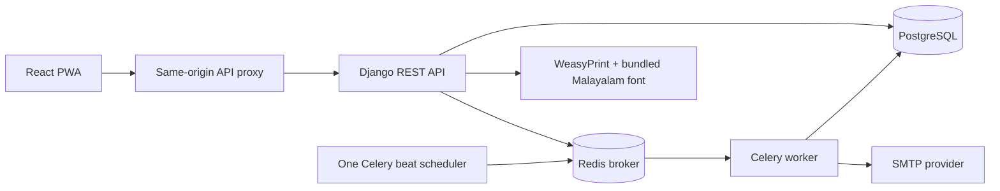

# Institution office

A multi-tenant school, tuition-centre and madrasa management platform. Institution configuration selects terminology, available modules and themes in one application. Staff, parents and students enter through invitations; institution registration creates the first administrator.

## Run in the prepared cloud workspace

```sh
cd /workspace/zaaf.learning
bash scripts/cloud-install.sh
bash scripts/cloud-start.sh
set -a
. /workspace/zaaf-cloud.env
set +a
cd backend
DEMO_PASSWORD='Local!Office!Seed!2026' /workspace/zaaf-venv/bin/python manage.py seed_demo
/workspace/zaaf-venv/bin/pytest -q
cd ../frontend
npm test
npm run build
npm run check:budget
```

The cloud helper uses the existing isolated checkout, native Python/Node dependencies, PostgreSQL and Redis containers, and background Django/Celery processes. It preserves `/workspace/zaaf-cloud.env` and existing data. Do not create a worktree. Source changes do not reload a backend launched with `--noreload`; restart only the processes this project started when needed. Logs and PID files are under `/tmp/zaaf-*`. Development email is printed to the backend/worker console. Never publish console email links or credentials.

For standard local Docker, copy `.env.example` to `.env` only if it does not already exist, replace the secret and database credentials, then run `docker compose up --build -d`. See [deployment and operations](DEPLOYMENT.md) for HTTPS, worker/scheduler, SMTP, managed hosting, Vercel/Netlify, export/deletion and release procedures. Docker image builds remain unverified in this cloud machine because build containers cannot resolve external registries; native setup is validated.

## Exact principal versions

Python 3.12.14, Django 5.2.18 LTS, DRF 3.16.1, SimpleJWT 5.5.1, PostgreSQL 16, WeasyPrint 70.0, Celery 5.6.3, Redis client 8.1.0 and Redis server 7.4. React 18.3.1, TypeScript 5.7.3, Vite 8.3.4, React Router 7.18.4, TanStack Query 5.66.9, TanStack Virtual 3.14.21, Zustand 5.0.3, React Hook Form 7.54.2, Zod 3.24.2, Tailwind 4.3.3, vite-plugin-pwa 2.0.0 and Vitest 5.0.5. Exact direct dependencies and resolved transitive versions are in the manifests and lockfiles. Node 24.19.0 is the Docker build runtime.

## Architecture



Backend domains are `accounts`, `institutions`, `students`, `attendance`, `exams`, `events`, `notices`, `medical`, `madrasa`, `tuition` and `audit`, with shared authorization/PDF helpers in `core`. Frontend features are route-split under `src/features`, shared API/session/lookup utilities under `src` and `src/lib`, and centralized response types plus typed feature contracts. The OpenAPI schema and Swagger UI are at `/api/schema/` and `/api/docs/`; they expose documentation, not tenant records. API operations require bearer authorization and selected tenant/role headers.

Tenant records have institution foreign keys. `User`, authentication attempts, Django auth metadata and JWT blacklist tables are global because authentication can precede tenant resolution; the institution is the tenant root. Querysets scope to tenant before object lookup; assignment and parent/self rules then constrain access. Membership selection never grants a role. Lists paginate. Bulk attendance and marks validate the entire request transactionally.

## Implemented workflows

- Registration, invitations, email/login-ID sign-in, password links and mandatory first-login changes; role switching, account activation/reset and session revocation.
- Academic years, class/batch groups, divisions, subjects, class/subject teacher assignments, student and guardian linking, search and profiles.
- Dedicated medical emergency cards, call links, audit trails and expiring, read-only break-glass access with administrator notification.
- Daily/session attendance with live counts, an IndexedDB outbox, revision conflict checks, late-edit policy, monthly/daily date ranges, CSV/PDF reports and role dashboard summaries.
- Exams and subjects, bulk score/absence entry, draft/publication, configurable grades, English/Malayalam PDF report cards, mark-sheet holds and manual/fee-based release.
- Event eligibility by academic year/group/division/tags, participation counts and selection, family notifications, targeted notices, WhatsApp share templates, a paginated unified timeline, and attendance/marks warnings.
- Madrasa Hifz progress, Islamic-studies marks using the common exam system, and school/madrasa timetables. Tuition installments, referenced payments, scheduled reminders, test series, ranks and batch performance.
- Institution settings, grading/attendance rules, logo validation, tenant CSV export and confirmed deletion. School fee notes use the audited timeline's fee-note kind.
- Three light/dark themes, English/Malayalam labels, installable PWA shell, scoped lookup caching, update prompts, virtualized large marking rosters and SVG trend charts.

## Authorization matrix

| Capability | Administrator | Class teacher | Subject teacher | Parent | Student |
| --- | --- | --- | --- | --- | --- |
| Institution/academic setup, accounts, export/delete | Yes | No | No | No | No |
| Student read | Tenant | Own class | Assigned classes | Linked children | Self |
| Student/guardian management | Tenant | Own class | No | No | No |
| Attendance writes | Tenant | Own class | No | No | No |
| Marks writes | Tenant | Own class | Assigned subject and class | No | No |
| Medical read/edit | Tenant | Own class | Read only with grant | No | No |
| Break-glass | Already authorized | Yes | Yes | No | No |
| Published marks/report read | Tenant | Assigned students | Assigned students | Linked, unheld | Self, unheld |
| Event selection, holds/release | Yes | Read assigned roster | Read assigned roster | Own child participation | Self |
| Notices | All audiences | Assigned groups | Read assigned groups | Targeted notices | Targeted notices |
| Tuition finance writes | Yes | Read assigned students | Read assigned students | Read linked children | No tuition login |
| Hifz writes | Yes | Own class | No | No | No madrasa login |

Attendance changes after 24 hours require direct administrator action under `ADMIN_ONLY`, or are blocked for everyone under `BLOCK`. Parents/students never receive held/draft marks through marks, reports, profile insights or timeline endpoints. Timetable and whole-batch test-series creation require whole-group management access; division-specific teachers cannot implicitly administer other divisions.

## Development data

Set `DEMO_PASSWORD` explicitly. The repeatable seed preserves existing passwords and records, and creates one institution of each type, every supported role, academic groups, students/guardians, medical cards, attendance, published exams, events, notices, and madrasa/tuition records. Phone numbers are clearly labelled test numbers and do not work.

| Institution | Logins |
| --- | --- |
| School | admin@school.example.test, teacher@school.example.test, subject@school.example.test, relief@school.example.test, parent@school.example.test, student@school.example.test |
| Tuition | admin@tuition.example.test, teacher@tuition.example.test, subject@tuition.example.test, relief@tuition.example.test, parent@tuition.example.test |
| Madrasa | admin@madrasa.example.test, teacher@madrasa.example.test, subject@madrasa.example.test, relief@madrasa.example.test, parent@madrasa.example.test |

The seeded class teacher also has a Parent membership for role-switch testing. Relief teachers have no normal class assignment and can exercise emergency search/grants. Newly invited identities receive generated one-time credentials; no production credentials are bundled. Browser validation records are explicitly named QA and are development-only.

## Security choices

Access JWTs remain in memory; rotating refresh cookies are HttpOnly and Secure in production, scoped to `/api/auth/`. Cookie-authentication mutations use CSRF protection; bearer API mutations do not rely on cookies. Password changes/deactivation increment an authorization version and blacklist refresh tokens. Every protected request reloads active-user and membership state. Passwords use Argon2 and strength validation. Identity-based failed-login lockouts are database-backed; anonymous endpoint throttling supplements an ingress rate limiter.

Medical responses are `no-store` and are never service-worker cached. PDF generation only fetches the bundled local font, escapes authored text and does not load arbitrary remote resources. Uploads reject SVG/invalid/oversized images and normalize accepted logos. Exports omit authentication secrets and escape spreadsheet formulas. Production requires real HTTPS origins, trusted proxy boundaries, secret storage, backups, SMTP and running workers. Institution deletion does not promise immediate erasure from provider backups or unrelated global accounts.

## Phase runbooks and evidence

[Phase 2](PHASE2.md), [Phase 3](PHASE3.md), [Phase 4](PHASE4.md), [Phase 5](PHASE5.md), [Phase 6](PHASE6.md), [Phase 7](PHASE7.md), [validation evidence](VALIDATION.md), [deployment](DEPLOYMENT.md).

The implementation and local checks do not establish deployment or external SMTP deliverability. Provider credentials and real hosting endpoints were not supplied. Lighthouse and automated accessibility results describe the measured build/environment; verify again against deployed latency, real mobile hardware and institutional accessibility requirements.
